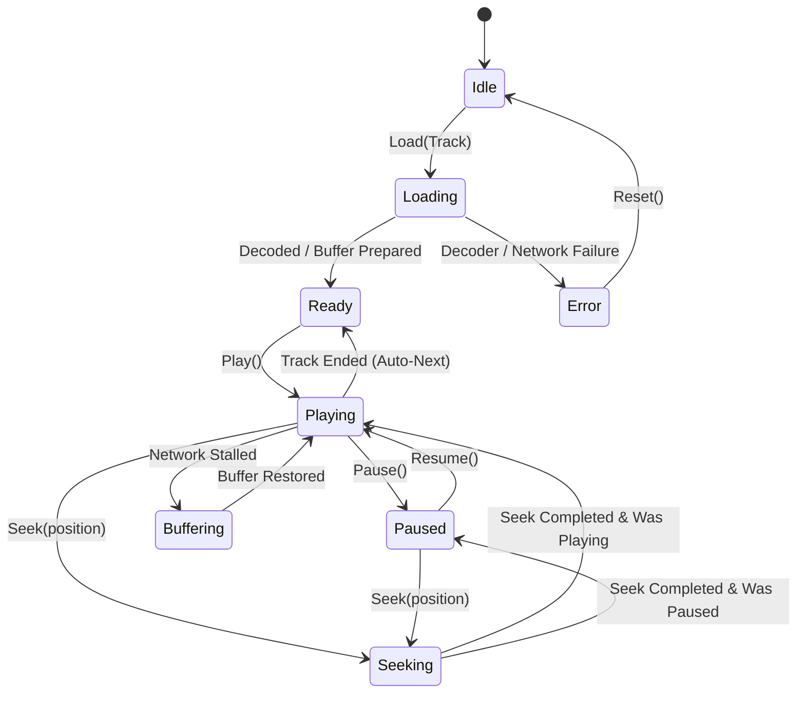
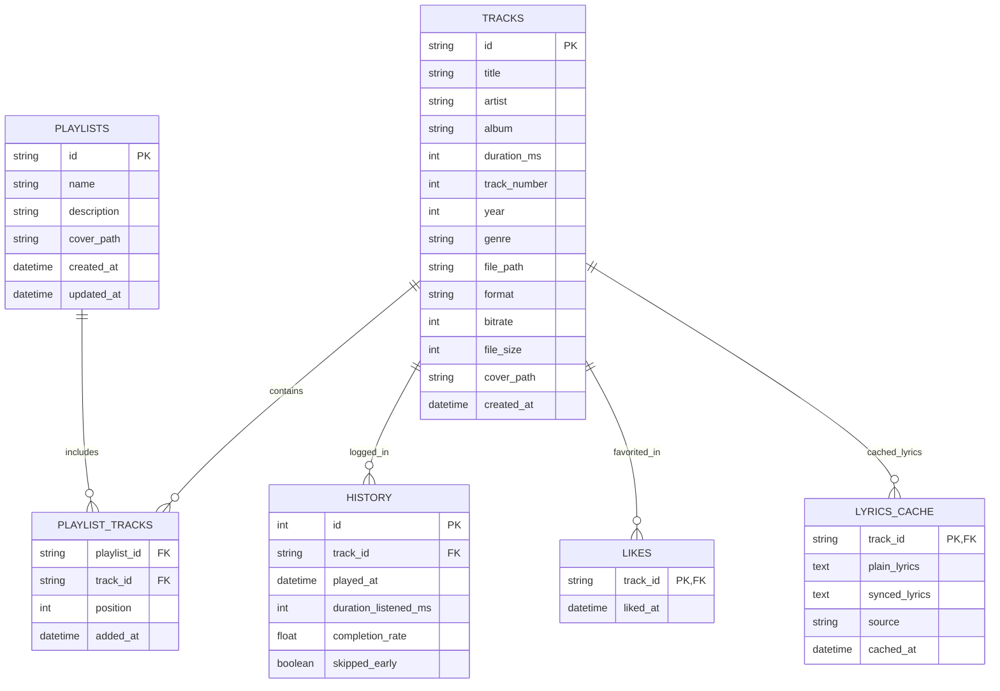

# inline Music Architecture Specification

## 1. System Overview

**inline Music** is an open-source, privacy-first audio ecosystem built as three completely native, high-performance applications for **Windows**, **Android**, and **Arch Linux**.

Unlike hybrid or cross-platform wrappers, each application is constructed using the optimal native technologies for its target platform, adhering to a unified product contract, design system, and audio pipeline.

```mermaid
flowchart TD
    subgraph Core Contract
        PP[Product & Design Contract]
        AS[Audio State Machine Contract]
        DBM[Local Database & Storage Schema]
        LRCS[Synced Lyrics & LRCLIB Protocol]
        WAVE[Wave Recommendation Algorithm]
    end

    subgraph Windows Native Application
        W_UI[WPF / Modern Fluent WinUI 3 UI]
        W_DWM[Windows DWM Mica / Acrylic Backdrops]
        W_AUDIO[NAudio / MediaFoundation Real DSP Engine]
        W_SMTC[Windows System Media Transport Controls]
        W_HK[Global Hotkeys & Mini-Player Window]
        W_DB[Microsoft.Data.Sqlite Local DB]
    end

    subgraph Android Native Application
        A_UI[Jetpack Compose & Material 3 Expressive]
        A_MEDIA[AndroidX Media3 / ExoPlayer Service]
        A_SESS[MediaSessionService & Notification Shade]
        A_EQ[Android AudioFX / Biquad 10-Band EQ]
        A_ROOM[Room SQLite Database & DataStore]
        A_WM[WorkManager & Foreground Downloads]
    end

    subgraph Arch Linux Native Application
        L_UI[Qt 6 / Qt Quick QML Liquid Glass UI]
        L_GST[GStreamer Pipeline playbin3 + equalizer-10bands]
        L_MPRIS[MPRIS2 D-Bus Interface org.mpris.MediaPlayer2]
        L_NOTIF[Desktop Notifications & Media Keys]
        L_DB[QtSql / SQLite Local DB]
        L_PKG[Arch PKGBUILD & Pacman Package]
    end

    PP --> W_UI
    PP --> A_UI
    PP --> L_UI

    AS --> W_AUDIO
    AS --> A_MEDIA
    AS --> L_GST

    DBM --> W_DB
    DBM --> A_ROOM
    DBM --> L_DB
```

---

## 2. Architectural Layers

Each native application strictly maintains separation of concerns across clean architecture layers:

1. **Presentation Layer**:
   - Modern, hardware-accelerated declarative UI (WinUI / Compose / QML).
   - ViewModels / Presenters isolating business logic from UI rendering.
   - Liquid Glass visual components, responsive layout adaptation, smooth spring physics animations.

2. **Domain Layer**:
   - Core business entities (`Track`, `Album`, `Artist`, `Playlist`, `HistoryEntry`, `PlaybackQueue`).
   - Wave Recommendation Engine (local collaborative filtering & tag-affinity algorithm).
   - Playback queue orchestration (linear, shuffle without duplicates, repeat one, repeat all).
   - Sleep timer management.

3. **Data Layer**:
   - Local relational database (SQLite via `Microsoft.Data.Sqlite`, `Room`, or `QtSql`).
   - Local tag parsing engine (ID3v1, ID3v2, FLAC Vorbis comments, MP4 tags).
   - Synchronized lyrics client and local cache.
   - Cache manager with configurable disk limits.

4. **Audio Layer**:
   - Strictly isolated background audio engine decoupled from the UI lifecycle.
   - Real-time 10-band IIR/Biquad parametric equalizer DSP.
   - Crossfade engine (sample-level fade out/fade in over configurable 0-12s curve).
   - Accurate duration, timecode, and seeking with zero race conditions.

5. **Platform Integration Layer**:
   - System media transport controls (SMTC on Windows, MediaSession on Android, MPRIS on Linux).
   - Multimedia hardware key dispatch and global shortcuts.
   - Floating mini-player orchestration and window behavior.
   - Audio focus handling (handling phone calls, notifications, headset unplugs).

---

## 3. Audio Engine State Machine

The audio engine adheres to a rigorous, finite state machine across all three platforms to eliminate desynchronization between audio output and user interface state:

### Safety Guarantees:
- **No Stale Responses**: Async operations tag requests with an atomic monotonic `RequestId`; older requests are discarded immediately upon arrival.
- **Corrupt File Tolerance**: If a track fails to decode or its file is missing, the engine logs the error, flags the item in the queue, and automatically advances to the next playable item without crashing.
- **Atomic Queue Manipulation**: Drag-and-drop reordering, removals, and inserts are thread-safe and never interrupt the currently playing stream.

---

## 4. Local Database Schema & Persistence

All user data remains strictly local on the device.

