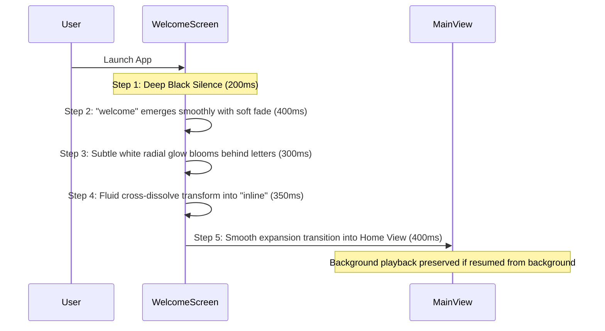

# inline Music Design System: Apple Music × Google Pixel UI (Liquid Glass)

## 1. Visual Philosophy

**inline** merges the refined, content-focused elegance of **Apple Music** with the bold, playful geometry and expressive ergonomics of **Google Pixel UI (Material 3 Expressive)**, elevated by a sophisticated **Liquid Glass** material depth.

### Core Principles
1. **Content First**: Artwork and typography guide the eye. UI controls are translucent, minimal, and non-intrusive.
2. **Deep Monochrome Foundation**: Pure deep black (`#000000`) canvas allows vibrant album art to pop with organic radiance.
3. **Multi-Layered Glass**: Layered translucent surfaces with delicate specular borders, soft backdrop blurs, and subtle inner glow.
4. **Tactile Spring Motion**: Interactive components exhibit weight, elasticity, and immediate visual feedback via spring physics.

---

## 2. Color System

The system palette is strictly monochromatic and neutral. Color enters solely through dynamic album artwork.

| Token | Hex / Value | Semantic Role |
| :--- | :--- | :--- |
| `color-bg-canvas` | `#000000` | Pure black root background |
| `color-surface-glass` | `rgba(28, 28, 30, 0.65)` | Primary elevated glass surface with backdrop blur |
| `color-surface-glass-active` | `rgba(44, 44, 46, 0.75)` | Interactive hovered or active glass state |
| `color-surface-panel` | `#0E0E11` | Secondary side panel / sheet backdrop |
| `color-border-subtle` | `rgba(255, 255, 255, 0.08)`| Subtle separation borders |
| `color-border-highlight` | `rgba(255, 255, 255, 0.20)`| Top specular light edge on glass cards |
| `color-text-primary` | `#FFFFFF` | Headings, active track titles, primary actions |
| `color-text-secondary` | `#8E8E93` | Artists, metadata, unselected tabs |
| `color-text-tertiary` | `#48484A` | Disabled states, subtle timestamps |
| `color-accent-pure` | `#FFFFFF` | Play/pause hero icons, progress thumb |

---

## 3. Liquid Glass Material Specification

Liquid Glass consists of three simultaneous visual layers:
1. **Backdrop Blur**: Hardware-accelerated blur (Windows Acrylic/Mica, Android `RenderEffect.createBlurEffect`, Qt QML `MultiEffect`).
2. **Specular Top Edge**: Linear gradient stroke on top border (`rgba(255, 255, 255, 0.25)` to `rgba(255, 255, 255, 0.04)`).
3. **Delicate Radial Ambient**: Soft graphite glow originating from center or top-left.

```css
/* Liquid Glass Concept */
.liquid-glass-card {
  background: rgba(24, 24, 28, 0.68);
  backdrop-filter: blur(24px) saturate(160%);
  border: 1px solid rgba(255, 255, 255, 0.10);
  border-top: 1px solid rgba(255, 255, 255, 0.22);
  box-shadow: 0 16px 32px rgba(0, 0, 0, 0.45);
  border-radius: 16px;
}
```

---

## 4. Typography Scale

Clean modern sans-serif grotesk (Inter / system font with Cyrillic support).

| Role | Size | Weight | Tracking / Line Height |
| :--- | :--- | :--- | :--- |
| **Hero Display** | 32 pt / 42 sp | 800 (ExtraBold) | -0.5px / 1.15 |
| **Title 1** | 24 pt / 30 sp | 700 (Bold) | -0.3px / 1.2 |
| **Title 2** | 20 pt / 24 sp | 600 (SemiBold) | 0px / 1.25 |
| **Body Primary** | 15 pt / 16 sp | 500 (Medium) | 0px / 1.35 |
| **Body Secondary**| 13 pt / 14 sp | 400 (Regular) | +0.1px / 1.4 |
| **Caption / Time**| 11 pt / 12 sp | 500 (Medium) | +0.4px (Tabular figures) |

---

## 5. Geometry & Squircles

- **Card Radius**: `16px` (desktop), `20px` (mobile).
- **Hero Artwork Radius**: `24px` with subtle shadow.
- **Pill Buttons**: `9999px` (fully rounded capsule).
- **Control Buttons**: `44px × 44px` minimum hit target.

---

## 6. Animated Welcome Screen Sequence



---

## 7. Motion & Spring Physics Principles

- **Spring Dynamics**: Stiffness 300, Damping 25, Mass 1.
- **Button Press**: Scale down to `0.96` on touch/pointer down, rebound with spring on release.
- **Like Toggle**: Spring bounce from `1.0` -> `0.85` -> `1.22` -> `1.0` with heart fill state change.
- **Track Transition**: Subtle crossfade of background artwork blur with 400ms ease-out.
- **Reduce Motion**: In system accessibility mode, spring physics collapse to instant 150ms linear opacity fades.
