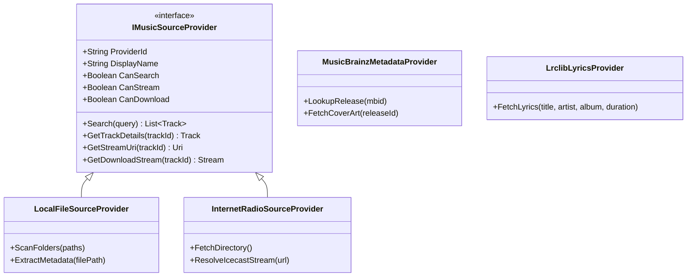

# inline Music Providers & Integrations Architecture

## 1. Modular Provider Architecture

The catalog and playback architecture in inline Music is decoupled via provider interfaces. This ensures the player core remains agnostic to whether audio data originates from a local NVMe drive, an open internet radio station, or an external stream.

---

## 2. Integrated Providers

### 2.1. Local File Source Provider (Primary)
- Recursively traverses user-designated music libraries.
- Extracts ID3v1, ID3v2.3, ID3v2.4, FLAC Vorbis comments, and MP4/M4A metadata tags.
- Extracts embedded album art (`APIC` / `covr` frames) and caches optimized webp/png miniatures locally.
- Detects filesystem modifications via native directory watchers without triggering heavy re-scans.

### 2.2. LRCLIB Synchronized Lyrics Provider
- Open-access synchronized lyrics API (`https://lrclib.net/api/get`).
- Queries by track title, artist name, album name, and duration tolerance (±2 seconds).
- Parses LRC timestamps (`[mm:ss.xx]`) with millisecond precision for real-time scrolling and karaoke line highlighting.
- Caches lyrics locally in SQLite for full offline availability.

### 2.3. MusicBrainz & Cover Art Archive
- Queries open music metadata via the MusicBrainz REST API.
- Strictly adheres to the User-Agent policy and rate limits (1 request per second).
- Retrieves official cover art from the Internet Archive / Cover Art Archive for local files lacking embedded images.

### 2.4. Open Audio Streams & Internet Radio
- Supports direct MP3, AAC, and OGG Icecast/Shoutcast streams.
- Dynamically parses ICY metadata (`StreamTitle`) for real-time now-playing updates.

---

## 3. Policy on External Platforms (VK, Spotify, Yandex Music)

inline Music adheres to strict legal and ethical software development standards:

1. **No DRM Bypassing**: The software does not circumvent Widevine, FairPlay, or proprietary digital rights management systems.
2. **No Cookie / Private Token Scraping**: inline Music does not hijack browser session cookies, extract internal app tokens, or spoof third-party applications.
3. **No Unofficial Reverse-Engineered Audio Endpoints**: Where external platforms (such as Spotify or VK) do not provide public, unauthenticated audio streaming APIs, inline Music respects their boundaries.
4. **Permitted Workflows**:
   - **Playlists & Metadata Import**: Users can import their existing libraries via standard exported M3U, CSV, or authorized public OAuth metadata endpoints.
   - **Local Matching**: When an imported playlist references a track, inline automatically matches it against the user's local audio library or open catalog.
